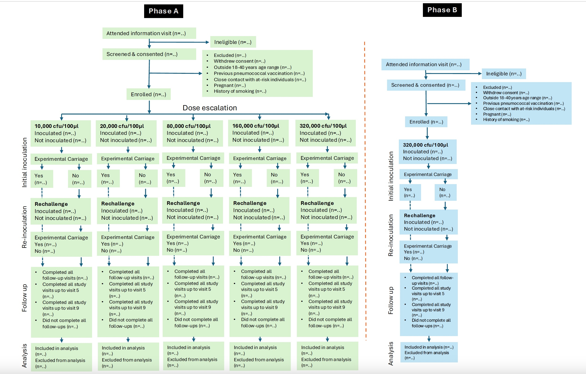

```{r setup}
#| include: false

library(tidyverse)
library(kableExtra)
library(knitr)
#library(grid)
#library(gridExtra)
library(table1)
#library(lme4)
library(gridExtra)
```

This initial SAP is outlined in sections that are to be updated according to the SPN3 dose finding protocol. We will keep track of all changes made to each SAP version and document these in the version history table.

# Full study title

Serotype 3 Dose Ranging and Reproducibility Experimental Human Pneumococcal Challenge in Healthy Volunteers.

# Short title

Experimental Human Pneumococcal Challenge with SPN3

# Acronym

PneumoDose-SPN3

# SAP Version History

```{r}
#| label: tbl-versionHistory
#| tbl-cap: "Version history listing major changes for each new version."

dfVersion<-data.frame(matrix(ncol=3,nrow=0, dimnames=list(NULL, c("Version", "Date", "Description"))))
dfVersion[nrow(dfVersion)+1,]<-c("v0.1","2024-08-29","First draft of the SAP; Puting all sections in place and initial data simulations.")
dfVersion[nrow(dfVersion)+1,]<-c("v0.2","2024-11-19","Review by Henrion; filling in most of the protocol sections, adding references and geenrally cleaning up the document.")
dfVersion[nrow(dfVersion)+1,]<-c("v0.3","2025-01-20","Addressing comments from Marc and incorporated the Consort diagram.")
dfVersion[nrow(dfVersion)+1,]<-c("v0.4","2025-06-05","Updated analysis sections, added GitHub repository link, and included the Dose response curve")
dfVersion[nrow(dfVersion)+1,]<-c("v1.0","2025-06-06","First effective version; Revision before finalisation: typos and layout changes, reporting updated to CONSORT2025 from CONSORT20210")

dfVersion[nrow(dfVersion):1,] %>%
  kable(row.names = FALSE) %>%
  kable_styling(full_width = FALSE)
```

# List of abbreviations

@tbl-abbr lists all abbreviations used throughout this document.

```{r}
#| echo: false
#| label: tbl-abbr
#| tbl-cap: "List of abbreviations"

dfAbbr<-data.frame(
  abbr=c("eCRF","AE","AR","SAE","SAR","SUSAR", "DMP", "SAP", "IDA", "IQR", "CI", "SD", "P25", "P75", "N", "n", "ITT", "MICE", "FCS", "LTFU"),
  details=c("Electronic Case report form","Adverse event","Adverse reaction","Serious adverse event","Serious adverse reaction","Suspected unexpected serious adverse reaction", "Data management plan", "Statistical analysis plan", "Initial data analysis", "Interquartile range", "Confidence interval", "Standard deviation", "25th percentile value", "75th percentile value", "Size of relevant analysis population", "Size of analysis population without missing values", "Intention-to-treat", "Multiple imputation using chained equations", "Fully conditional specification", "Loss to follow-up")
)

dfAbbr<-dfAbbr[order(dfAbbr$abbr),]

dfAbbr %>%
  kable(row.names=F,col.names=c("Abbreviation","Explanation")) %>%
  kable_styling(full_width=FALSE)
```

# Protocol version

This Statistical Analysis Plan (SAP) v1.0 is based on Protocol v4.0, dated 12 February 2024 and approved by NHSRC.

# Protocol summary

The overall objective of the MARVELS PneumoDose-SPN3 study is to determine the optimal dose of SPN3 required to establish nasopharyngeal (NP) colonisation in healthy adults, using the EHPC model, in a population of healthy volunteers in Malawi.

## Study design

The study consists of a dose ranging and safety study (Phase A), and a reproducibility study (Phase B).

Healthy adult participants aged 18-50 will be nasally inoculated with pure culture of well-characterised, fully sequenced amoxicillin-sensitive SPN3. They will be observed for safety and development of pneumococcal colonisation and immune responses.

*Phase A - Dose ranging*:

Sequential cohorts of 10 healthy participants will be challenged with escalating doses of SPN3 until a cohort experiences 6 or more colonised participants ≥( 60%).

We will start at 10,000 CFU/naris and after n=10, escalate to 20,000 CFU/naris (n=10), 80,000 CFU/naris (n=10), 160,000CFU/naris and then 320,000 CFU/naris if safe to do so. We may increase the dose further depending on colonisation rates after consultation with the DSMB. Targeted repeat inoculations will be given to participants on D14, if they have tested negative for SPN3 on D2 and D7 samples. If optimum colonisation rates are achieved (≥60%) in any of the lower doses, the higher dose escalation groups may not be completed - this will be discussed with the TSC before a decision to omit the higher doses is made. Dose escalation can occur once 10 participants have been inoculated with the previous dose, provided there are no safety concerns.

*Phase B - Reproducibility*:

33 participants will be inoculated with SPN3 using the dose that results in ≥60% colonisation acquisition rate to check for reproducibility of carriage rate and immunological responses.

Additional specific immune parameters will be assessed during this phase to describe human immunity to SPN3 and compare the results with previous data obtained for SPNSPN3.

## Inclusion and exclusion criteria

### Inclusion criteria

-   Healthy adults aged 18-50 years.

-   Fluent spoken English and/or Chichewa. Capacity to give informed consent.

-   HIV negative.

-   Access to their own mobile telephone.

### Exclusion criteria

-   Currently involved in another study unless observational or non-interventional.

-   Participant in any previous EHPC trial in past year.

-   Previous pneumococcal vaccination. This can be self-reported or confirmed from the health passport fi deemed necessary at clinician discretion.

-   HIV positive.

-   Allergy to penicillin/amoxicillin.

-   Chronic ill health including immunosuppressive history, diabetes, asthma o(n regular medication), recurrent otitis media or other respiratory disease.

-   Medication that may affect the immune system e.g., steroids, inflammation altering or disease-modifying anti- rheumatoid drugs.

-   Long term use of antibiotics for chronic infection.

-   Major pneumococcal illness requiring hospitalisation ni the last 10 years.

-   Other conditions considered by hte clinical team asaconcern for participant safety or integrity of hte sutdy

-   Significant mental health problems (uncontrolled condition or requiring previous admission to a psychiatric unit) that would impair ability to participate.

-   Direct caring role or close contact with individuals at higher risk of infection

    -   Children under 5 years of age.
    -   Adults with chronic ill health or immunosuppression.
    -   Hospital patients.

-   Smoker

    -   Current or ex-smoker in the past 6 months. Participants who smoke \<5 cigarettes per week may be included.
    -   Previous significant smoking history (\>20 cigarettes per day for 20 years or equivalent \[\>20 pack years\].

-   Pregnancy:

    -   Currently pregnant/lactating.
    -   Intending on becoming pregnant during the study

-   History of or current drug or alcohol abuse:

    -   Men should not drink \>3 units/day regularly.
    -   Women should not drink \>2 units/day regularly.

-   Overseas travel planned during follow-up period of study visits.

-   Natural SPN3 colonisation in baseline nasal wash - if aparticipant is colonised with non-SPN3 pneumococcus, they can be included as part of exploratory analyses, but would not be included in the primary analysis.

-   STOP criteria - participants who meet STOP criteria at the time of screening (see Table 2 from Protocol).

## Withdrawal criteria

Participants will be informed in both the participant information leaflet and participant presentation that they may withdraw from the study at any time and that this will not have any effect on them. Samples already collected prior to withdrawal will continue to be used in the research.

Participants may be withdrawn from the study for the following reasons:

-   If they become pregnant.
-   If they develop a condition that forms part of exclusion criteria.
-   If a medication is started that would affect the study results (e.g., antibiotics).
-   Any concern about participant safety including that posed by new medication prescriptions or medical issues, or compliance with monitoring appointments (at the discretion of the study physician).

### Replacement of withdrawn or lost-to-follow-up participants

We will replace participants who are excluded during post-inoculation follow up to recruit the pre-specified allocated number of participants to each group.

## Study Endpoints

**Primary endpoint**:

The primary endpoint is SPN3 carriage rate (overall colonisation status): Defined as presence of SPN3 in nasal wash at any of the post-inoculation visits (i.e. carriage day 2, 7, 13, 16, 21 and 28 post-inoculation visits), by classical microbiology and/or molecular methods.

The primary safety endpoint is the occurrence of any adverse, serious adverse, suspected related and unexpected suspected related events.

**Secondary endpoints**:

Secondary endpoints are: carriage density at individual study visits and area under the curve of log-density at the different study visits.

Carriage density at individual visits (quantitative culture results at each nasal wash timepoint).

Overall carriage density (e.g., AUC of log-transformed density over time)

Duration of colonisation of the nasopharynx.

Rate of adverse events post-inoculation.

Sensitivity comparison in detecting colonization between nasal wash and nasopharyngeal swab using culture and PCR (samples from the reproducibility study).

Carriage in saliva vs nasopharyngeal samples – rates, density, and duration (samples from the reproducibility study)..

Effect of natural SPN (non-SPN3) colonisation on SPN3 carriage (samples from the reproducibility study).

Immunological endpoints – antibody levels, memory B cells, mucosal immune cell profiles, cytokine responses.

## Sample size

The maximum total sample size for MARVELS PneumoDose-SPN3 is n=104 participants. This results from 10 individuals at each dose (50 in total) and 33 for the reproducibility phase. The sample size of n=83 is then inflated for an expected 20% drop-out/screening failure for the resulting sample size of n=104.

The numbers at each stage have been chosen for pragmatic reasons and have not been selected to guarantee statistical power for a specific analysis or to guarantee estimation of a given parameter up to a certain level of precision. We do not thate from the combined sample size (n=10+33) at the final chosen dose, this would allow estimation of the carriage proportion up to a margin of error of 15%, assuming 60% carriage.

## Aims and objectives

**Aim1:** *To determine the optimal SPN3 dose to establish colonisation of the nasopharynx in healthy adults.*

Specific objectives:

-   To establish the dose of SPN3 carriage following experimental pneumococcal inoculation

-   To ascertain the rate of experimental colonisation acquisition of SPN3 in healthy adults post inoculation, by microbiological and molecular methods.

-   To establish the rate of adverse events recorded following experimental pneumococcal inoculation

-   To determine the density of experimental SPN3 colonisation of the nasopharynx

-   To determine the duration of experimental SPN3 colonisation of the nasopharynx.

-   To evaluate participant satisfaction with study participation following experimental pneumococcal inoculation

-   To compare rate of pneumococcal carriage following experimental pneumococcal inoculation with different doses.

**Aim2:** *To understand local and systemic immunological responses to SPN3 colonisation.*

Specific objectives:

-   To characterise mucosal immune cell populations and dynamics in response to SPN3 experimental inoculation in nasal cell samples.

-   To determine the level of mucosal and systemic SPN3 polysaccharide-specific antibodies at baseline and after SPN3 experimental inoculation (samples obtained in reproducibility study).

-   To determine the levels of polysaccharide specific SPN3 memory Bcells at baseline and after SPN3 experimental inoculation (samples obtained in reproducibility study).

-   To describe nasal inflammatory kinetics induced by SPN3 experimental inoculation (samples obtained in reproducibility study).

-   To determine the effect of natural SPN (non-SPN3) colonisation on SPN3 colonisation (samples obtained ni reproducibility study).

-   To compare rates, density and duration of SPN3 colonisation in saliva versus nasopharyngeal samples (samples obtained in reproducibility study).

# Data simulation

In order to demonstrate the planned analyses and show computer code, we will simulate mock study data.

## Generate mock data

We assume the study proceeded all the way to dose CFU 320,000 with 10 participants recruited to each stage (all receiving SPN3 inoculation at the respective dose).

We also assume no repeat inoculation in the reproducibility study.

```{r Simulation}
set.seed(123)
n=83 # this is our sample size
mockDat<-data.frame(
  stage=c(rep("A",10),rep("B",10),rep("C",10), rep("D",10), rep("E",10), rep("F",33)),
  phase=c(rep("Dose-ranging",10),rep("Dose-ranging",10),rep("Dose-ranging",10),rep("Dose-ranging",10),rep("Dose-ranging",10), rep("Reproducibility",33)),
  substage=c(rep("2",10),rep("1",1),rep("2",9),rep("1",3),rep("2",7),rep("1",4),rep("2",6), rep("1",6), rep("2",4), rep("3",33)),
  PID=formatC(width=2,format="d",flag="0",c(rep(1:10,5),1:33)),
  sex=sample(size=83,x=c("Male","Female"),prob=c(0.70,0.30),replace=T),
  age = round(rnorm(n, mean = 25, sd = 6.5), 1),
  dose=c(rep(10000,10),rep(20000,10),rep(80000,10),rep(160000,10),rep(320000,43)),
  actualDosePre=NA,
  actualDosePost=NA,
  min_temperature=NA,
  max_temperature=NA,
  doseTimeDiff=NA,
  inoculation=NA,
  
  carriageSPN3=NA,
  #carriageSPN3_Dm5=0,
  carriageSPN3_D2=0,
  carriageSPN3_D7=0,
  carriageSPN3_D13=0,
  carriageSPN3_D16=0,
  carriageSPN3_D21=0,
  carriageSPN3_D28=0,
  
  carriageSPN3_lytA=NA,
  carriageSPN3_Dm5_lytA=0,
  carriageSPN3_D2_lytA=0,
  carriageSPN3_D7_lytA=0,
  carriageSPN3_D13_lytA=0,
  carriageSPN3_D16_lytA=0,
  carriageSPN3_D21_lytA=0,
  carriageSPN3_D28_lytA=0,
  
  carriageNonSPN3=NA,
  carriageNonSPN3_Dm5=0,
  carriageNonSPN3_D2=0,
  carriageNonSPN3_D7=0,
  carriageNonSPN3_D13=0,
  carriageNonSPN3_D16=0,
  carriageNonSPN3_D21=0,
  carriageNonSPN3_D28=0,
  
  densitySPN3_D2=0,
  densitySPN3_D7=0,
  densitySPN3_D13=0,
  densitySPN3_D16=0,
  densitySPN3_D21=0,
  densitySPN3_D28=0,
  
  densitySPN3_D2_lytA=0,
  densitySPN3_D7_lytA=0,
  densitySPN3_D13_lytA=0,
  densitySPN3_D16_lytA=0,
  densitySPN3_D21_lytA=0,
  densitySPN3_D28_lytA=0,
  
  AE1=0,
  AE2=0,
  AE3=0,
  sym1=NA,
  sym2=NA,
  sym3=NA,
  SAE=0,
  SAR=0,
  SUSAR=0
)

symptoms<-c("Sore throat","Coryzal symptoms","Headache","Earache","Feverish","Cough","New rash","Other")
sympProb<-c(0.35,0.025,0.1,0.15,0.1,0.15,0.1,0.025)

mockDat$PID<-paste(sep="-","SPN3",mockDat$stage,mockDat$PID)
mockDat$inoculation<- "spn3"

mockDat$actualDosePre<-rnorm(nrow(mockDat),mean=mockDat$dose,sd=mockDat$dose/25)
mockDat$actualDosePost<-rnorm(nrow(mockDat),mean=mockDat$actualDosePre,sd=ifelse(mockDat$dose==0,0,800))

mockDat$doseTimeDiff<-round(digits=0,rnorm(nrow(mockDat),mean=45,sd=10))

mockDat$min_temperature<-round(digits=1,rnorm(nrow(mockDat),mean=22,sd=1.5))
mockDat$max_temperature<-mockDat$min_temperature+round(digits=1,abs(rnorm(nrow(mockDat),mean=2,sd=0.5)))


mockDat <- mockDat %>% mutate(carriageSPN3 = ifelse(substage == 1 & phase == "Dose-ranging", 1, 0))

stage_10000 <- mockDat$dose == 10000 & mockDat$substage == 2
mockDat$carriageSPN3[stage_10000] <- rbinom(sum(stage_10000),1,0.01)

stage_20000 <- mockDat$dose == 20000 & mockDat$substage == 2
mockDat$carriageSPN3[stage_20000] <- rbinom(sum(stage_20000),1,0.05)

stage_80000 <- mockDat$dose == 80000 & mockDat$substage == 2
mockDat$carriageSPN3[stage_80000] <- rbinom(sum(stage_80000),1,0.10)

stage_160000 <- mockDat$dose == 160000 & mockDat$substage == 2
mockDat$carriageSPN3[stage_160000] <- rbinom(sum(stage_160000),1,0.15)

stage_320000 <- mockDat$dose == 320000 & mockDat$substage == 2
mockDat$carriageSPN3[stage_320000] <- rbinom(sum(stage_320000),1,0.20)
  
phase_320000 <- mockDat$dose == 320000 & mockDat$phase == "Reproducibility"
mockDat$carriageSPN3[phase_320000] <- rbinom(sum(phase_320000),1,0.65)

## Visit carriage for the single inoculated participants
idxTmp<-which(mockDat$carriageSPN3==1 & mockDat$substage==1)
carDayTmp<-sample(size=length(idxTmp),c(2,7),prob=c(0.4,0.6),replace=T)

mockDat$carriageSPN3_D2[idxTmp[carDayTmp==2]]<-1

mockDat$carriageSPN3_D7[idxTmp[carDayTmp==7]]<-1
mockDat$carriageSPN3_D7[idxTmp[carDayTmp==2]]<-sample(0:1,prob=c(0.7,0.3),replace=TRUE,size=sum(carDayTmp==2))

mockDat$carriageSPN3_D13[idxTmp[carDayTmp==2]]<-sample(0:1,prob=c(0.85,0.15),replace=TRUE,size=sum(carDayTmp==2))
mockDat$carriageSPN3_D13[idxTmp[carDayTmp==7]]<-sample(0:1,prob=c(0.75,0.25),replace=TRUE,size=sum(carDayTmp==2))

mockDat$carriageSPN3_D16[idxTmp[carDayTmp==2]]<-NA
mockDat$carriageSPN3_D16[idxTmp[carDayTmp==7]]<-NA

mockDat$carriageSPN3_D21[idxTmp[carDayTmp==2]]<-NA
mockDat$carriageSPN3_D21[idxTmp[carDayTmp==7]]<-NA

mockDat$carriageSPN3_D28[idxTmp[carDayTmp==2]]<-NA
mockDat$carriageSPN3_D28[idxTmp[carDayTmp==7]]<-NA

## Visit carriage for the re-challenged participants
idxTmp<-which(mockDat$carriageSPN3==1 & mockDat$substage==2)
carDayTmp<-sample(size=length(idxTmp),c(13,16,21,28),prob=c(0.1,0.4,0.35,0.15),replace=T)

mockDat$carriageSPN3_D16[idxTmp[carDayTmp==13]]<-1

mockDat$carriageSPN3_D16[idxTmp[carDayTmp==16]]<-1
mockDat$carriageSPN3_D16[idxTmp[carDayTmp==13]]<-sample(0:1,prob=c(0.8,0.2),replace=TRUE,size=sum(carDayTmp==13))

mockDat$carriageSPN3_D21[idxTmp[carDayTmp==21]]<-1
mockDat$carriageSPN3_D21[idxTmp[carDayTmp==13]]<-sample(0:1,prob=c(0.95,0.15),replace=TRUE,size=sum(carDayTmp==13))
mockDat$carriageSPN3_D21[idxTmp[carDayTmp==16]]<-sample(0:1,prob=c(0.8,0.2),replace=TRUE,size=sum(carDayTmp==16))

mockDat$carriageSPN3_D28[idxTmp[carDayTmp==28]]<-1
mockDat$carriageSPN3_D28[idxTmp[carDayTmp==13]]<-sample(0:1,prob=c(0.98,0.02),replace=TRUE,size=sum(carDayTmp==13))
mockDat$carriageSPN3_D28[idxTmp[carDayTmp==16]]<-sample(0:1,prob=c(0.9,0.1),replace=TRUE,size=sum(carDayTmp==16))
mockDat$carriageSPN3_D28[idxTmp[carDayTmp==21]]<-sample(0:1,prob=c(0.8,0.2),replace=TRUE,size=sum(carDayTmp==21))

## Visit carriage for the reproducibility study
idxTmp<-which(mockDat$carriageSPN3==1 & mockDat$substage==3)
carDayTmp<-sample(size=length(idxTmp),c(2,7,13,16,21,28),prob=c(0.30,0.30,0.10,0.15,0.10,0.05),replace=T)

mockDat$carriageSPN3_D2[idxTmp[carDayTmp==2]]<-1

mockDat$carriageSPN3_D7[idxTmp[carDayTmp==7]]<-1
mockDat$carriageSPN3_D7[idxTmp[carDayTmp==2]]<-sample(0:1,prob=c(0.8,0.2),replace=TRUE,size=sum(carDayTmp==2))

mockDat$carriageSPN3_D13[idxTmp[carDayTmp==13]]<-1
mockDat$carriageSPN3_D13[idxTmp[carDayTmp==2]]<-sample(0:1,prob=c(0.95,0.05),replace=TRUE,size=sum(carDayTmp==2))
mockDat$carriageSPN3_D13[idxTmp[carDayTmp==7]]<-sample(0:1,prob=c(0.85,0.15),replace=TRUE,size=sum(carDayTmp==7))

mockDat$carriageSPN3_D16[idxTmp[carDayTmp==16]]<-1
mockDat$carriageSPN3_D16[idxTmp[carDayTmp==2]]<-NA
mockDat$carriageSPN3_D16[idxTmp[carDayTmp==7]]<-NA
mockDat$carriageSPN3_D16[idxTmp[carDayTmp==13]]<-sample(0:1,prob=c(0.8,0.2),replace=TRUE,size=sum(carDayTmp==13))

mockDat$carriageSPN3_D21[idxTmp[carDayTmp==21]]<-1
mockDat$carriageSPN3_D21[idxTmp[carDayTmp==2]]<-NA
mockDat$carriageSPN3_D21[idxTmp[carDayTmp==7]]<-NA
mockDat$carriageSPN3_D21[idxTmp[carDayTmp==13]]<-sample(0:1,prob=c(0.95,0.05),replace=TRUE,size=sum(carDayTmp==13))
mockDat$carriageSPN3_D21[idxTmp[carDayTmp==16]]<-sample(0:1,prob=c(0.8,0.2),replace=TRUE,size=sum(carDayTmp==16))

mockDat$carriageSPN3_D28[idxTmp[carDayTmp==28]]<-1
mockDat$carriageSPN3_D28[idxTmp[carDayTmp==2]]<-NA
mockDat$carriageSPN3_D28[idxTmp[carDayTmp==7]]<-NA
mockDat$carriageSPN3_D28[idxTmp[carDayTmp==13]]<-sample(0:1,prob=c(0.98,0.02),replace=TRUE,size=sum(carDayTmp==13))
mockDat$carriageSPN3_D28[idxTmp[carDayTmp==16]]<-sample(0:1,prob=c(0.95,0.05),replace=TRUE,size=sum(carDayTmp==16))
mockDat$carriageSPN3_D28[idxTmp[carDayTmp==21]]<-sample(0:1,prob=c(0.8,0.2),replace=TRUE,size=sum(carDayTmp==21))

# lytA carriage
mockDat<-mockDat %>%
  dplyr::mutate(
    carriageSPN3_D2_lytA=rbinom(n=n(),size=1,prob=ifelse(carriageSPN3_D2==1,0.95,0.05)),
    carriageSPN3_D7_lytA=rbinom(n=n(),size=1,prob=ifelse(carriageSPN3_D7==1,0.95,0.05)),
    carriageSPN3_D13_lytA=rbinom(n=n(),size=1,prob=ifelse(carriageSPN3_D13==1,0.95,0.05)),
    carriageSPN3_D16_lytA=rbinom(n=n(),size=1,prob=ifelse(carriageSPN3_D16==1,0.95,0.02)),
    carriageSPN3_D21_lytA=rbinom(n=n(),size=1,prob=ifelse(carriageSPN3_D21==1,0.95,0.02)),
    carriageSPN3_D28_lytA=rbinom(n=n(),size=1,prob=ifelse(carriageSPN3_D28==1,0.95,0.02))
  )

mockDat$carriageSPN3_D16_lytA[is.na(mockDat$carriageSPN3_D16)]<-NA
mockDat$carriageSPN3_D21_lytA[is.na(mockDat$carriageSPN3_D21)]<-NA
mockDat$carriageSPN3_D28_lytA[is.na(mockDat$carriageSPN3_D28)]<-NA

mockDat<-mockDat %>%
  dplyr::mutate(
    carriageSPN3_lytA=max(carriageSPN3_D2_lytA,carriageSPN3_D7_lytA,carriageSPN3_D13_lytA,carriageSPN3_D16_lytA,carriageSPN3_D21_lytA,carriageSPN3_D28_lytA,na.rm=TRUE)
  )

# Carriage Density for carriers
mockDat$densitySPN3_D2[mockDat$carriageSPN3_D2==1]<-rexp(sum(mockDat$carriageSPN3_D2==1),rate=5/mockDat$dose[mockDat$carriageSPN3_D2==1])

mockDat$densitySPN3_D7[mockDat$carriageSPN3_D7==1 & mockDat$carriageSPN3_D2==1]<-rexp(sum(mockDat$carriageSPN3_D7==1 & mockDat$carriageSPN3_D2==1),rate=1/mockDat$densitySPN3_D2[mockDat$carriageSPN3_D7==1 & mockDat$carriageSPN3_D2==1])

mockDat$densitySPN3_D7[mockDat$carriageSPN3_D7==1 &
mockDat$carriageSPN3_D2==0]<-rexp(sum(mockDat$carriageSPN3_D7==1 & mockDat$carriageSPN3_D2==0),rate=5/mockDat$dose[mockDat$carriageSPN3_D7==1 & mockDat$carriageSPN3_D2==0])

mockDat$densitySPN3_D13[mockDat$carriageSPN3_D13==1 & mockDat$carriageSPN3_D7==1]<-rexp(sum(mockDat$carriageSPN3_D13==1 & mockDat$carriageSPN3_D7==1),rate=1/mockDat$densitySPN3_D7[mockDat$carriageSPN3_D13==1 & mockDat$carriageSPN3_D7==1])

mockDat$densitySPN3_D13[mockDat$carriageSPN3_D13==1 & mockDat$carriageSPN3_D7==0]<-rexp(sum(mockDat$carriageSPN3_D13==1 & mockDat$carriageSPN3_D7==0),rate=5/mockDat$dose[mockDat$carriageSPN3_D13==1 & mockDat$carriageSPN3_D7==0])

mockDat$densitySPN3_D2<-round(mockDat$densitySPN3_D2,digits=0)
mockDat$densitySPN3_D7<-round(mockDat$densitySPN3_D7,digits=0)
mockDat$densitySPN3_D13<-round(mockDat$densitySPN3_D13,digits=0)

# Non-SPN3 carriage 
mockDat$carriageNonSPN3_Dm5<-rbinom(size=1,n=nrow(mockDat),prob=1/(12*7))
mockDat$carriageNonSPN3_D2<-rbinom(size=1,n=nrow(mockDat),prob=1/(12*7))
mockDat$carriageNonSPN3_D7<-rbinom(size=1,n=nrow(mockDat),prob=1/(12*7))
mockDat$carriageNonSPN3_D13<-rbinom(size=1,n=nrow(mockDat),prob=1/(12*7))
mockDat$carriageNonSPN3_D16<-rbinom(size=1,n=nrow(mockDat),prob=1/(12*7))
mockDat$carriageNonSPN3_D21<-rbinom(size=1,n=nrow(mockDat),prob=1/(12*7))
mockDat$carriageNonSPN3_D28<-rbinom(size=1,n=nrow(mockDat),prob=1/(12*7))

mockDat$carriageNonSPN3=apply(FUN=max,MARGIN=1,X=mockDat %>% select(carriageNonSPN3_Dm5,carriageNonSPN3_D2,carriageNonSPN3_D7,carriageNonSPN3_D13,carriageNonSPN3_D16,carriageNonSPN3_D21,carriageNonSPN3_D28),na.rm=TRUE)

# recoding dose groups
mockDat<-mockDat %>%
  mutate(
    Group=dplyr::recode(stage,"A"="10,000 CFU","B"="20,000 CFU","C"="80,000 CFU", "D"="160,000 CFU", "E"="320,000 CFU", "F"="320,000 CFU")
  )
mockDat$Group<-factor(mockDat$Group,levels=c("10,000 CFU","20,000 CFU","80,000 CFU","160,000 CFU","320,000 CFU"))

mockDat$AE1<-sample(0:1,size=nrow(mockDat),prob=c(0.75,0.25),replace=T)
mockDat$AE2[mockDat$AE1==1]<-sample(0:1,size=sum(mockDat$AE1==1),prob=c(0.9,0.1),replace=T)
mockDat$AE3[mockDat$AE2==1]<-sample(0:1,size=sum(mockDat$AE2==1),prob=c(0.95,0.05),replace=T)

mockDat$sym1[mockDat$AE1==1]<-sample(symptoms,size=sum(mockDat$AE1==1),prob=sympProb,replace=T)
mockDat$sym2[mockDat$AE2==1]<-sample(symptoms,size=sum(mockDat$AE2==1),prob=sympProb,replace=T)
mockDat$sym2[mockDat$AE3==1]<-sample(symptoms,size=sum(mockDat$AE3==1),prob=sympProb,replace=T)
```

### Summary statistics for the simulated data

Below is the summary statistics for the simulated data showing: numbers of participants, sex (male/female) distribution, colonisation rates for each dose and for the reproducibility study

```{r}
# 1. Bar chart: Participants per dose
ggplot(mockDat, aes(x = as.factor(dose), fill = dose)) +
  geom_bar() +
  labs(title = "Number of Participants per Dose", x = "Dose", y = "Count") +
  theme_minimal() +
  theme(legend.position = "none")

# 2. Bar chart: Sex distribution
ggplot(mockDat, aes(x = sex, fill = sex)) +
  geom_bar() +
  labs(title = "Sex Distribution", x = "Sex", y = "Count") +
  theme_minimal()


# 3. CarriageSPN3 by dose
simDat <- mockDat
plotDat<-simDat %>%
  group_by(dose, phase) %>%
  summarise(
    n=n(),
    k=sum(carriageSPN3),
    .groups="drop") %>%
  mutate(
    prop=k/n,
    propLow=NA,
    propUpp=NA
  )

for(j in 1:nrow(plotDat)){
  ci<-binom.test(x=plotDat$k[j],n=plotDat$n[j])$conf.int
  plotDat$propLow[j]<-ci[1]
  plotDat$propUpp[j]<-ci[2] 
}

rm(ci)


plotDat %>%
  ggplot(mapping=aes(x=as.factor(dose),y=prop,ymin=propLow,ymax=propUpp,fill=dose)) +
  geom_bar(stat="identity",alpha=0.9) +
  geom_errorbar(width=0.2,col="darkgrey") +
  #scale_fill_manual(values=c(blueCols,orangeCols)) +
  xlab("Inoculation dose") +
  ylab("carriage proportion") +
  guides(fill="none") +
  theme_light() +
  facet_wrap(~phase)+
  labs(title="Simulated data: carriage proportion per inoculation dose .",caption="The confidence interval bars are only indicative of how wide confidence intervals can be expected for such data.")
```

# Statistical Analysis Plan

The R code to generate the results is embedded in this document. By default it is hidden, but can be displayed by clicking on the `Show the code` indicators.

## General considerations

The reporting of this study will be prepared in accordance with the CONSORT 2025 guidelines [@hopewell_etal2025].

All continuous data variables will be summarized using the following descriptive statistics:

-   N (size of relevant analysis population)
-   n (size of analysis population without missing values)
-   arithmetic mean (or geometric mean if more appropriate)
-   standard deviation (SD)
-   median
-   25th percentile value (P25), 75th percentile value (P75) and interquartile range (IQR)
-   minimum and maximum (where relevant)

The proportion / percentage of observed levels will be reported for all binary and categorical measures. When appropriate, corresponding exact 95% confidence intervals (CIs) for proportions will be included.

For statistical test, a significance level of 5% will be used. All p-values will be reported to 3 decimal digits.

### Reporting conventions

P-values $\geq 0.001$ and $\leq 0.999$ will be reported to 3 decimal places; p-values less than 0.001 will be reported as "\< 0.001". The mean, standard deviation, median, IQR and other statistics will be reported to one decimal place greater than the original data. Minimum and maximum values will use the same number of decimal places as the original data. Proportions will be presented as two decimal places; values greater than zero but $<0.01$ will be presented as "\< 0.01". Percentages will be reported to 2 decimal places; values greater than zero but $<0.01\%$ will be presented as "\< 0.01%"; values greater than $99.99\%$ but less than $100\%$ will be reported as "\> 99.99%". Estimated parameters, not on the same scale as raw observations (e.g. regression coefficients) will be reported to 3 significant figures.

### Missing data

As participants who withdraw or become ineligible before the inoculation visit will be replaced, we expect near to no loss-to-follow-up. For this reason, the main analysis will be a complete-case analysis.

While we do not anticipate much missing data, should missing data, for whatever reason, be more substantial than expected, we will use multiple imputation for the analysis. Specifically we will use fully conditional specification (FCS) as implemented in Multiple Imputation using Chained Equations (MICE, @vanBuurenGroothuisOudshoorn2011) and the `mice` package in R, with at least m=5 imputations or more if the missingness proportion is substantial.

### Technical details

The R environment for statistical computing (v4.5.0 or later) will be used for all analyses.

All analysis code will be made publicly available under an MIT or GNU GPL v3.0 license on GitHub.

All analysis code used for data simulation, statistical analysis, will be publicly available in a public GitHub repository under the MIT License.

The repository is accessible at:

[https://github.com/mlw-stats/MARVELS_SPN3_SAP](https://github.com/mlw-stats/MARVELS_SPN3_SAP)

### Analysis population

The analysis population will include all participants who received SPN3 inoculation and had complete follow-up nasal wash samples collected at all scheduled post-inoculation timepoints (Days 2, 7, 13, 16, 21, and 28)

### CONSORT diagram and participant characteristics

The very first analysis we will do will be descriptive: we will summarise the screening, recruitment, randomisation to vaccination arms, complete follow-up numbers using a standard CONSORT flow diagram as illustrated on Figure 1.

```{r}
#| label: fig-consort
#| fig-cap: "(MOCK FIGURE) CONSORT diagram for the SPN3 dose ranging study."
#| fig-height: 36
#| fig-width: 18


```

### Patient characteristics

We will list the participants' characteristics by phase, see @tbl-participantCharacteristics.

```{r}
#| label: tbl-participantCharacteristics
#| tbl-cap: "(MOCK TABLE) Participant characteristics."

mockDat$dose <- factor(mockDat$dose, levels = c("10000", "20000", "80000", "160000", "320000"))

mockDat$carriageSPN3_fct <- factor(mockDat$carriageSPN3, levels = c("0", "1"), labels = c("No", "Yes") )

render.median.IQR <- function(x, ...) {
  c('', 
    `Mean (SD)` = sprintf("%s (%s)", round(mean(x), 2), round(sd(x), 2)),
    `Median [IQR]` = sprintf("%s [%s, %s]", round(median(x),2), 
                             quantile(x, 0.25), quantile(x, 0.75)))
}


table1(~sex + age + dose + carriageSPN3_fct | phase, data = mockDat)
```

## Primary Analysis

The primary efficacy outcome is SPN3 colonisation, defined as detection of serotype SPN3 in nasal wash samples at any time point post-inoculation.

#### Overall carriage rates

We will summarise the proportion of participants who carried pneumococcal (serotype SPN3) following inoculation with SPN3 across the different dose levels. Carriage rates are presented by the dose group, with corresponding 95% confidence intervals. For the final selected dose (320,000 CFU) group, results are also stratified by study phase (dose-ranging vs reproducibility).

```{r }
#| label: tbl-carriageRatesByDose
#| tbl-cap: "(MOCK TABLE) SPN3 carriage rates by dose."

# overall carriage rates
mockDat320 <- mockDat %>%
  mutate(
    Group = case_when(
      dose == 320000 & phase == "Dose-ranging" ~ "Dose-ranging 320kCFU",
      dose == 320000 & phase == "Reproducibility" ~ "Reproducibility 320kCFU",
      TRUE ~ as.character(dose)
    )
  ) %>%
  filter(dose==320000)

mockDat_combined <- rbind(mockDat, mockDat320)

carrRes<-mockDat_combined %>%
  group_by(Group) %>%
  summarise(
    n=n(),
    n_SPN3=sum(carriageSPN3==1),
    prop_SPN3=sum(carriageSPN3==1)/n(),
    prop_SPN3_low=NA,
    prop_SPN3_high=NA,
    propCI_SPN3=NA,
    n_NonSPN3=sum(carriageNonSPN3==1),
    prop_NonSPN3=sum(carriageNonSPN3==1)/n(),
    prop_NonSPN3_low=NA,
    prop_NonSPN3_high=NA,
    propCI_NonSPN3=NA
  )

for(j in 1:nrow(carrRes)){
  ci<-binom.test(x=carrRes$n_SPN3[j],n=carrRes$n[j])$conf.int
  carrRes$prop_SPN3_low[j]<-ci[1]
  carrRes$prop_SPN3_high[j]<-ci[2]
  ci<-paste(sep="",format(nsmall=1,round(digits=1,100*ci)),"%")
  carrRes$propCI_SPN3[j]<-paste(sep="","(",paste(collapse=",",ci),")")
  ci<-binom.test(x=carrRes$n_NonSPN3[j],n=carrRes$n[j])$conf.int
  carrRes$prop_NonSPN3_low[j]<-ci[1]
  carrRes$prop_NonSPN3_high[j]<-ci[2]
  ci<-paste(sep="",format(nsmall=1,round(digits=1,100*ci)),"%")
  carrRes$propCI_NonSPN3[j]<-paste(sep="","(",paste(collapse=",",ci),")")
  rm(ci)
}

carrRes$prop_SPN3_text<-paste(sep="",format(nsmall=1,round(digits=2,100*carrRes$prop_SPN3)),"%")
carrRes$prop_NonSPN3_text<-paste(sep="",format(nsmall=1,round(digits=2,100*carrRes$prop_NonSPN3)),"%")

carrRes %>%
  dplyr::select(Group,n,n_SPN3,prop_SPN3_text,propCI_SPN3,n_NonSPN3,prop_NonSPN3_text,propCI_NonSPN3) %>%
  kable(row.names=F,col.names=c("","Total","Count","Percentage","95% CI","Count","Percentage","95% CI")) %>%
  kable_styling(full_width = F) %>%
  add_header_above(c(" "=2,"SPN3 Carriage"=3,"Non-SPN3 Carriage"=3))

write.csv(carrRes,file="MARVELSFeasibility_Table8.1_CarriageRates.csv")
```

```{r}
#| label: fig-carriageRatesByDose
#| fig-cap: "(MOCK FIGURE) SPN3 carriage rates by dose."

g<-carrRes %>%
  ggplot(mapping=aes(x=Group,y=prop_SPN3,fill=Group)) +
  geom_bar(stat="identity",col=NA) +
  geom_errorbar(mapping=aes(ymin=prop_SPN3_low,ymax=prop_SPN3_high),width=0.15,col="grey60",lwd=0.75) +
  scale_fill_manual(values=c("steelblue", "darkseagreen3", "lightgoldenrod1", "peachpuff2", "salmon", "tan", "lightblue"),name="") +
  guides(fill=FALSE) +
  theme_light() +
  theme(text=element_text(size=10),
        axis.text.x = element_text(angle = 45, hjust = 1)) +
  xlab("Dose") +
  ylab("Carriage proportion") +
  ggtitle("Carriage rates by dose") +
  ylim(c(0,1)) +
  geom_vline(xintercept=5.5,col="darkgrey",lwd=1.5,lty=2) 

print(g)

png(width=16,height=9,units="in",res=300,filename="MARVELSFeasibility_Fig8.2_CarriageByGroup.png")
print(g)
dev.off()
```

### Carriage rates by study visits

We will also present SPN3 carriage proportions stratified by both dose group and post-inoculation visit. We will show this overall and via separate figures for those who were not re-challenged (which are those individuals with carriage at either the day 2 or the day 7 post-inoculation visit) and those who were (i.e. those without carriage at days 2 and 7). We will show the the reproducibility cohort daat separately on these graphs.


```{r}
#| label: fig-carriageRatesByStudyVisitByDose
#| fig-cap: "(MOCK FIGURE) SPN3 carriage rates by study visit and inoculation dose."

## carriage rates over time
sumFunCarrVisitDose<-function(dat){
  carrResVisit<-dat %>%
    group_by(Group) %>%
    summarise(
      k_SPN3_2=sum(carriageSPN3_D2==1,na.rm=TRUE),
      n_SPN3_2=sum(!is.na(carriageSPN3_D2)),
      prop_SPN3_2=sum(carriageSPN3_D2==1,na.rm=TRUE)/sum(!is.na(carriageSPN3_D2)),
      propLow_SPN3_2=NA,
      propHigh_SPN3_2=NA,
      k_SPN3_7=sum(carriageSPN3_D7==1,na.rm=TRUE),
      n_SPN3_7=sum(!is.na(carriageSPN3_D7)),
      prop_SPN3_7=sum(carriageSPN3_D7==1,na.rm=TRUE)/sum(!is.na(carriageSPN3_D7)),
      propLow_SPN3_7=NA,
      propHigh_SPN3_7=NA,
      k_SPN3_13=sum(carriageSPN3_D13==1,na.rm=TRUE),
      n_SPN3_13=sum(!is.na(carriageSPN3_D13)),
      prop_SPN3_13=sum(carriageSPN3_D13==1,na.rm=TRUE)/sum(!is.na(carriageSPN3_D13)),
      propLow_SPN3_13=NA,
      propHigh_SPN3_13=NA,
      k_SPN3_16=sum(carriageSPN3_D16==1,na.rm=TRUE),
      n_SPN3_16=sum(!is.na(carriageSPN3_D16)),
      prop_SPN3_16=sum(carriageSPN3_D16==1,na.rm=TRUE)/sum(!is.na(carriageSPN3_D16)),
      propLow_SPN3_16=NA,
      propHigh_SPN3_16=NA,
      k_SPN3_21=sum(carriageSPN3_D21==1,na.rm=TRUE),
      n_SPN3_21=sum(!is.na(carriageSPN3_D21)),
      prop_SPN3_21=sum(carriageSPN3_D21==1,na.rm=TRUE)/sum(!is.na(carriageSPN3_D21)),
      propLow_SPN3_21=NA,
      propHigh_SPN3_21=NA,
      k_SPN3_28=sum(carriageSPN3_D28==1,na.rm=TRUE),
      n_SPN3_28=sum(!is.na(carriageSPN3_D28)),
      prop_SPN3_28=sum(carriageSPN3_D28==1,na.rm=TRUE)/sum(!is.na(carriageSPN3_D28)),
      propLow_SPN3_28=NA,
      propHigh_SPN3_28=NA,
    )
  
  for(j in 1:nrow(carrResVisit)){
    if(carrResVisit$n_SPN3_2[j]>0){
      ci<-binom.test(x=carrResVisit$k_SPN3_2[j],n=carrResVisit$n_SPN3_2[j])$conf.int
      carrResVisit$propLow_SPN3_2[j]<-ci[1]
      carrResVisit$propHigh_SPN3_2[j]<-ci[2]
    }
    if(carrResVisit$n_SPN3_7[j]>0){
      ci<-binom.test(x=carrResVisit$k_SPN3_7[j],n=carrResVisit$n_SPN3_7[j])$conf.int
      carrResVisit$propLow_SPN3_7[j]<-ci[1]
      carrResVisit$propHigh_SPN3_7[j]<-ci[2]
    }
    if(carrResVisit$n_SPN3_13[j]>0){
      ci<-binom.test(x=carrResVisit$k_SPN3_13[j],n=carrResVisit$n_SPN3_13[j])$conf.int
      carrResVisit$propLow_SPN3_13[j]<-ci[1]
      carrResVisit$propHigh_SPN3_13[j]<-ci[2]
    }
    if(carrResVisit$n_SPN3_16[j]>0){
      ci<-binom.test(x=carrResVisit$k_SPN3_16[j],n=carrResVisit$n_SPN3_16[j])$conf.int
      carrResVisit$propLow_SPN3_16[j]<-ci[1]
      carrResVisit$propHigh_SPN3_16[j]<-ci[2]
    }
    if(carrResVisit$n_SPN3_21[j]>0){
      ci<-binom.test(x=carrResVisit$k_SPN3_21[j],n=carrResVisit$n_SPN3_21[j])$conf.int
      carrResVisit$propLow_SPN3_21[j]<-ci[1]
      carrResVisit$propHigh_SPN3_21[j]<-ci[2]
    }
    if(carrResVisit$n_SPN3_28[j]>0){
      ci<-binom.test(x=carrResVisit$k_SPN3_28[j],n=carrResVisit$n_SPN3_28[j])$conf.int
      carrResVisit$propLow_SPN3_28[j]<-ci[1]
      carrResVisit$propHigh_SPN3_28[j]<-ci[2]
    }
  }
  
  carrResLong<-carrResVisit %>%
    pivot_longer(cols=c(k_SPN3_2,n_SPN3_2,prop_SPN3_2,propLow_SPN3_2,propHigh_SPN3_2,
                        k_SPN3_7,n_SPN3_7,prop_SPN3_7,propLow_SPN3_7,propHigh_SPN3_7,
                        k_SPN3_13,n_SPN3_13,prop_SPN3_13,propLow_SPN3_13,propHigh_SPN3_13,
                        k_SPN3_16,n_SPN3_16,prop_SPN3_16,propLow_SPN3_16,propHigh_SPN3_16,
                        k_SPN3_21,n_SPN3_21,prop_SPN3_21,propLow_SPN3_21,propHigh_SPN3_21,
                        k_SPN3_28,n_SPN3_28,prop_SPN3_28,propLow_SPN3_28,propHigh_SPN3_28),
                 names_pattern="(.*)_SPN3_(.*)",
                 names_to=c("statistic","visit"),
                 values_to="value") %>%
    pivot_wider(names_from=statistic,values_from=value) %>%
    tidyr::complete(Group,visit,fill=list(k=0,n=0,prop=NA,propLow=NA,propHigh=NA))
  
  carrResLong<-carrResLong[order(carrResLong$Group,as.integer(carrResLong$visit)),]

  carrResLong$Day<-factor(carrResLong$visit,levels=c("2","7","13","16","21","28"))
  
  return(carrResLong)
}


### all visits, all participants
carrResLong<-sumFunCarrVisitDose(mockDat_combined)

g1<-carrResLong %>%
  ggplot(mapping=aes(x=Day,y=prop,fill=Group,col=Group)) +
  geom_bar(stat="identity",position=position_dodge(width=1)) +
  geom_errorbar(mapping=aes(ymin=propLow,ymax=propHigh),stat="identity",width=0.3,col="grey60",lwd=0.5,position=position_dodge(width=1)) +
  scale_fill_manual(values=c("steelblue", "darkseagreen3", "lightgoldenrod1", "peachpuff2", "salmon", "tan", "lightblue"),name="Dose") +
  scale_color_manual(values=c("steelblue", "darkseagreen3", "lightgoldenrod1", "peachpuff2", "salmon", "tan", "lightblue"),name="Dose") +
  theme_light() +
  theme(text=element_text(size=10)) +
  xlab("Days post initial inoculation") +
  ylab("Carriage proportion") +
  ggtitle("a. All participants") +
  ylim(c(0,max(carrResLong$propHigh)))

### days 2, 7, 13, no re-challenge participants
carrResLong<-sumFunCarrVisitDose(mockDat_combined %>% dplyr::filter(mockDat_combined$carriageSPN3_D2==1 | mockDat_combined$carriageSPN3_D7==1))

g2<-carrResLong %>%
  ggplot(mapping=aes(x=Day,y=prop,fill=Group,col=Group)) +
  geom_bar(stat="identity",position=position_dodge(width=1)) +
  geom_errorbar(mapping=aes(ymin=propLow,ymax=propHigh),stat="identity",width=0.3,col="grey60",lwd=0.5,position=position_dodge(width=1)) +
  scale_fill_manual(values=c("steelblue", "darkseagreen3", "lightgoldenrod1", "peachpuff2", "salmon", "tan", "lightblue"),name="Dose") +
  scale_color_manual(values=c("steelblue", "darkseagreen3", "lightgoldenrod1", "peachpuff2", "salmon", "tan", "lightblue"),name="Dose") +
  theme_light() +
  theme(text=element_text(size=10),legend.position="none") +
  xlab("Days post initial inoculation") +
  ylab("Carriage proportion") +
  ggtitle("b. Single-challenge participants") +
  ylim(c(0,max(carrResLong$propHigh)))

### days 13, 16, 21, 28, re-challenged participants
carrResLong<-sumFunCarrVisitDose(mockDat_combined %>% dplyr::filter(mockDat_combined$carriageSPN3_D2==0 & mockDat_combined$carriageSPN3_D7==0))

g3<-carrResLong %>%
  ggplot(mapping=aes(x=Day,y=prop,fill=Group,col=Group)) +
  geom_bar(stat="identity",position=position_dodge(width=1)) +
  geom_errorbar(mapping=aes(ymin=propLow,ymax=propHigh),stat="identity",width=0.3,col="grey60",lwd=0.5,position=position_dodge(width=1)) +
  scale_fill_manual(values=c("steelblue", "darkseagreen3", "lightgoldenrod1", "peachpuff2", "salmon", "tan", "lightblue"),name="Dose") +
  scale_color_manual(values=c("steelblue", "darkseagreen3", "lightgoldenrod1", "peachpuff2", "salmon", "tan", "lightblue"),name="Dose") +
  theme_light() +
  theme(text=element_text(size=10),legend.position="none") +
  xlab("Days post initial inoculation") +
  ylab("Carriage proportion") +
  ggtitle("c. Re-challenged participants") +
  ylim(c(0,max(carrResLong$propHigh)))

grid.arrange(nrow=2,g1,g2,g3,layout_matrix=matrix(c(1,1,2,3),byrow=T,nrow=2))

png(width=16,height=9,units="in",res=300,filename="MARVELSFeasibility_Fig8.3_CarriageOverTime.png")
grid.arrange(nrow=2,g1,g2,g3,layout_matrix=matrix(c(1,1,2,3),byrow=T,nrow=2))
dev.off()
```


### DOSE RESPONSE CURVE

For the figure below, we fit a logistic dose-response model to estimate the ED50 i.e the dose at which 50% of participants carry pneumococcus

```{r}
#| label: tbl-doseResponseCurve
#| fig-tbl: "(MOCK TABLE) Summary of the dose-response model fitted to SPN3 challenge data."

set.seed(123)

SPN3_sim<-mockDat %>%
  dplyr::mutate(
    doseConcAvg=(actualDosePre+actualDosePost)/2
  )

SPN3_sim$carriageSPN3 <- as.numeric(as.character(SPN3_sim$carriageSPN3))
SPN3_sim$cfu <- as.numeric(gsub("[^0-9]", "", SPN3_sim$dose))

modDrcGlm<-glm(carriageSPN3~log(doseConcAvg),data=SPN3_sim, family=binomial)

edFun<-function(modGlm,prob=0.5){
  cfs<-coef(summary(modGlm))[,"Estimate"]
  ed<-exp((log(prob/(1-prob))-cfs[1])/cfs[2])
  return(ed)
}

ed50<-edFun(modDrcGlm)

B<-1e4
ed50Vect<-rep(NA,B)
for(b in 1:B){
  simDatBS<-SPN3_sim[sample(1:nrow(SPN3_sim),size=nrow(SPN3_sim),replace=TRUE),]
  modDrcGlmBS<-  glm(carriageSPN3~log(doseConcAvg),data=simDatBS,family=binomial)
  ed50Vect[b]<-edFun(modDrcGlmBS)
}

ed50CI<-quantile(ed50Vect,probs=c(0.025,0.975))
ed50Mod<-format(nsmall=0,trim=TRUE,big.mark=",",round(digits=0,c(ed50,ed50CI)))

modDrcSum<-summary(modDrcGlm)$coefficients %>%
  as.data.frame()
modDrcSum<-modDrcSum %>%
  mutate(parameter=rownames(modDrcSum))
colnames(modDrcSum)<-c("Estimate","Std.Error","z.value","p.value","parameter")

modDrcSum %>%
  mutate(p.value=ifelse(parameter!="(Intercept)" & p.value<0.05,cell_spec(format(nsmall=4,round(digits=4,p.value)),bold=T),cell_spec(format(nsmall=4,round(digits=4,p.value)),bold=F))) %>%
  dplyr::select(!parameter) %>%
  kbl(escape=FALSE,col.names=c("Estimate","Std. error","z value","p value"),caption=paste(sep="","Summary of the dose-response model fitted to SPN3 challenge data. ED50, the minimum dose that will on average result in 50% carriage is estimated to be ",ed50Mod[1]," with 95% CI (",paste(collapse=", ",ed50Mod[2:3]),").")) %>%
  kableExtra::kable_styling(full_width = FALSE)
```

```{r}
#| label: fig-doseResponseCurve
#| fig-cap: "(MOCK FIGURE) SPN3 dose response curve."

### CURVE
dfPred<-data.frame(
  logDoseConcAvg=seq(log(1),log(400000),length=2000)
) %>%
  mutate(
    doseConcAvg=exp(logDoseConcAvg)
  )

tmpPred<-as.data.frame(predict(modDrcGlm,newdata=dfPred,interval="link",se.fit=TRUE))

invLogit<-function(x){
  res<-exp(x)/(1+exp(x))
  return(res)
}

dfPred<-dfPred %>%
  dplyr::mutate(
    y=invLogit(tmpPred$fit),
    yLow=invLogit(tmpPred$fit-qnorm(0.975)*tmpPred$se.fit),
    yUpp=invLogit(tmpPred$fit+qnorm(0.975)*tmpPred$se.fit),
  )

### CURVE
tmpDat<-SPN3_sim %>%
  dplyr::group_by(cfu) %>%
  dplyr::summarise(
    n=n(),
    k=sum(carriageSPN3),
    propCarriage=mean(carriageSPN3)
  ) %>%
  mutate(
    propCarriageLow=NA,
    propCarriageUpp=NA
  )

for(j in 1:nrow(tmpDat)){
  tmp<-binom.test(x=tmpDat$k[j],n=tmpDat$n[j])$conf.int
  tmpDat$propCarriageLow[j]<-tmp[1]
  tmpDat$propCarriageUpp[j]<-tmp[2]
}


g_carriers<-ggplot() +
  geom_segment(mapping=aes(x=ed50,xend=ed50,y=0,yend=0.5),lty=2,lwd=0.5,col="steelblue") +
  geom_segment(mapping=aes(x=0,xend=ed50,y=0.5,yend=0.5),lty=2,lwd=0.5,col="steelblue") +
  geom_ribbon(mapping=aes(xmin=ed50CI[1],xmax=ed50CI[2],y=seq(0,1,length=100)),fill="steelblue",alpha=0.25) +
  geom_line(data=dfPred,mapping=aes(x=doseConcAvg,y=y),col="orange",lwd=1) +
  geom_ribbon(data=dfPred,mapping=aes(x=doseConcAvg,ymin=yLow,ymax=yUpp),fill="orange",alpha=0.25) +
  geom_point(data=SPN3_sim,mapping=aes(x=doseConcAvg,y=carriageSPN3),col="darkgrey",alpha=0.5,size=2.5) +
  geom_point(data=tmpDat,mapping=aes(x=cfu,y=propCarriage),col="black",size=5) +
  geom_errorbar(dat=tmpDat,mapping=aes(x=cfu,ymin=propCarriageLow,ymax=propCarriageUpp),width=2000) +
  xlab("Dose (CFU/μL)") +
  ylab("Probability of carriage") + 
  theme_light() + 
  ggtitle("") +
  theme(text=element_text(size=18)) +
  scale_x_continuous(labels = scales::comma_format(scale = 1, big.mark = "")) +
  coord_cartesian(xlim=c(0,320000))

print(g_carriers)
```


## Secondary analyses

Secondary analyses will be performed to further investigate the SPN3 colonisation dynamics and the host responses. This will include the following:

Duration of SPN3 carriage among colonised participants

Carriage density over time and by dose group

Comparison of SPN3 detection between classical culture and molecular (lytA PCR) methods

Association between baseline characteristics (e.g., sex, age) and likelihood of carriage

### Carriage density

This section summarises the density of SPN3 colonisation among participants who experienced SPN3 carriage, as measured by classical microbiology. Carriage density was assessed at each follow-up visit (Days 2, 7, 13, 16, 21, and 28) and is expressed as colony-forming units (CFU) per mL of nasal wash.

For each dose group and at each study visit (Days 2, 7, and 13), we will calculate the geometric mean density of SPN3 among colonised participants.

```{r carriageDensity}
tabDens<-data.frame(gmDensD2=rep(NA,5),gmDensD2_low=NA,gmDensD2_high=NA,gm95CID2=NA,gmDensD7=NA,gmDensD7_low=NA,gmDensD7_high=NA,gm95CID7=NA,gmDensD13=NA,gmDensD13_low=NA,gmDensD13_high=NA,gm95CID13=NA)
rownames(tabDens)<-c("10,000 CFU","20,000 CFU","80,000 CFU","160,000 CFU", "320,000 CFU")


for(dose in c(10,20,80,160,320)){
  for(day in c(2,7,13)){
    x<-mockDat_combined[mockDat_combined$dose==1000*dose & mockDat_combined[,paste(sep="","carriageSPN3_D",day)]==1,paste(sep="","densitySPN3_D",day)]
    tabDens[paste(sep="",dose,",000 CFU"),paste(sep="","gmDensD",day)]<-round(digits=0,exp(mean(log(x))))
    se<-sd(log(x))/sqrt(length(x))
    ci<-exp(mean(log(x))+c(-qnorm(0.975)*se,qnorm(0.975)*se))
    tabDens[paste(sep="",dose,",000 CFU"),paste(sep="","gmDensD",day,"_low")]<-ci[1]
    tabDens[paste(sep="",dose,",000 CFU"),paste(sep="","gmDensD",day,"_high")]<-ci[2]
    tabDens[paste(sep="",dose,",000 CFU"),paste(sep="","gm95CID",day)]<-paste(sep="","(",paste(collapse=",",round(digits=0,ci)),")")
  }
}

tabDens[tabDens=="(NA,NA)"]<-"not enough data"
tabDens$gmDensD2[is.nan(tabDens$gmDensD2)]<-"--"
tabDens$gmDensD7[is.nan(tabDens$gmDensD7)]<-"--"
tabDens$gmDensD13[is.nan(tabDens$gmDensD13)]<-"--"

tabDens %>%
  dplyr::select(c(gmDensD2,gm95CID2,gmDensD7,gm95CID7,gmDensD13,gm95CID13)) %>%
  kable(caption="Geometric mean densities and associated 95% confidence intervals among colonised participants.",col.names=c("Day 2","(95% CI)","Day 7","(95% CI)","Day 13","(95% CI)")) %>%
  kable_styling(full_width = F)

tabDens %>%
  dplyr::select(c(gmDensD2,gm95CID2,gmDensD7,gm95CID7,gmDensD13,gm95CID13)) %>%
  write.csv(file="MARVELS-SPN3Feasibility_Table8.4_CarriageDensity.csv")

tabDens$dose<-factor(rownames(tabDens),levels=c("10,000 CFU","20,000 CFU","80,000 CFU","160,000 CFU","320,000 CFU"))

tmp<-tabDens %>%
  dplyr::select(dose,gmDensD2,gmDensD7,gmDensD13) %>%
  pivot_longer(cols=c(gmDensD2,gmDensD7,gmDensD13),names_to="day",values_to="gmDens") %>%
  transmute(dose=dose,day=as.integer(gsub(pattern="gmDensD",replacement="",day)),gmDens=as.numeric(gmDens))

tmpLow<-tabDens %>%
  dplyr::select(dose,gmDensD2_low,gmDensD7_low,gmDensD13_low) %>%
  pivot_longer(cols=c(gmDensD2_low,gmDensD7_low,gmDensD13_low),names_to="day",values_to="gmDensLow") %>%
  transmute(dose=dose,day=as.integer(gsub(pattern="_low",replacement="",gsub(pattern="gmDensD",replacement="",day))),gmDensLow=as.numeric(gmDensLow))

tmpHigh<-tabDens %>%
  dplyr::select(dose,gmDensD2_high,gmDensD7_high,gmDensD13_high) %>%
  pivot_longer(cols=c(gmDensD2_high,gmDensD7_high,gmDensD13_high),names_to="day",values_to="gmDensHigh") %>%
  transmute(dose=dose,day=as.integer(gsub(pattern="_high",replacement="",gsub(pattern="gmDensD",replacement="",day))),gmDensHigh=as.numeric(gmDensHigh))

tabDensForPlot<-data.frame(tmp,gmDensLow=tmpLow$gmDensLow,gmDensHigh=tmpHigh$gmDensHigh)

# Adjust the x-axis (day) values for specific doses for clarity
tabDensForPlot$day[tabDensForPlot$dose == "10,000 CFU"] <- tabDensForPlot$day[tabDensForPlot$dose == "10,000 CFU"] - 0.3
tabDensForPlot$day[tabDensForPlot$dose == "20,000 CFU"] <- tabDensForPlot$day[tabDensForPlot$dose == "20,000 CFU"] - 0.2
tabDensForPlot$day[tabDensForPlot$dose == "160,000 CFU"] <- tabDensForPlot$day[tabDensForPlot$dose == "160,000 CFU"] + 0.2
tabDensForPlot$day[tabDensForPlot$dose == "320,000 CFU"] <- tabDensForPlot$day[tabDensForPlot$dose == "320,000 CFU"] + 0.3

```

We will visualize the pneumococcal carriage density over time among carriers, stratified by inoculation dose. The plot shows the geometric mean densities on days 2, 7, and 13 post-inoculation, with confidence intervals.

```{r}
# Create the plot
g <- ggplot() +
  geom_line(data = tabDensForPlot, mapping = aes(x = day, y = gmDens, col = dose), lwd = 1.25) +
  geom_point(data = tabDensForPlot, mapping = aes(x = day, y = gmDens, col = dose), cex = 2) +
  geom_errorbar(data = tabDensForPlot, mapping = aes(x = day, ymin = gmDensLow, ymax = gmDensHigh, col = dose), alpha = 0.5, lwd = 1.25, width = 0.2) +
  scale_color_manual(values = c("steelblue", "darkseagreen3", "lightgoldenrod1", "peachpuff2", "salmon"), name = "Dose") +
  geom_point(data = mockDat, mapping = aes(x = 2 + case_when(Group == "10,000 CFU" ~ -0.3, Group == "20,000 CFU" ~ -0.2, Group == "80,000 CFU" ~ 0, Group == "160,000 CFU" ~ 0.2, Group == "320,000 CFU" ~ 0.3), y = densitySPN3_D2, col = Group), cex = 2, pch = 4) +
  geom_point(data = mockDat, mapping = aes(x = 7 + case_when(Group == "10,000 CFU" ~ -0.3, Group == "20,000 CFU" ~ -0.2, Group == "80,000 CFU" ~ 0, Group == "160,000 CFU" ~ 0.2, Group == "320,000 CFU" ~ 0.3), y = densitySPN3_D7, col = Group), cex = 2, pch = 4) +
  geom_point(data = mockDat, mapping = aes(x = 13 + case_when(Group == "10,000 CFU" ~ -0.3, Group == "20,000 CFU" ~ -0.2, Group == "80,000 CFU" ~ 0, Group == "160,000 CFU" ~ 0.2, Group == "320,000 CFU" ~ 0.3), y = densitySPN3_D13, col = Group), cex = 2, pch = 4) +
  scale_x_continuous(breaks = c(2, 7, 13)) +
  scale_y_continuous(trans = 'log10') +
  theme_light() +
  theme(text = element_text(size = 10)) +
  ylab("Geometric mean density (CFU/mL)") +
  xlab("Day")

# Display the plot
print(g)

png(width=16,height=9,units="in",res=300,filename="MARVELSFeasibility_Fig8.4_CarriageDensityOverTime.png")
print(g)
dev.off()


```


### Inoculum

Inoculum Variability and Temperature

This plot shows the relationship between minimum temperature on the day of inoculation and the difference between post- and pre-inoculation CFU.

```{r}
#| label: fig-diffPrePostInoculumCFUTemperatureMin
#| fig-cap: "(MOCK FIGURE) Difference between pre- and post-inoculation CFU vs. minimum temperature."

mockDat<-mockDat %>%
  mutate(cfu_diff=actualDosePost-actualDosePre)

g1<-mockDat %>%
  ggplot(mapping=aes(x=min_temperature,y=cfu_diff,col=Group)) +
  geom_smooth(alpha=0.5,col="orange") +
  geom_point(cex=2) +
  scale_color_manual(values=c("steelblue", "darkseagreen3", "lightgoldenrod1", "peachpuff2", "salmon"),name="Dose") +
  xlab("miniumum temperature") +
  ylab("CFU post - CFU pre") +
  theme_light() +
  theme(text=element_text(size=10)) +
  ggtitle("Difference between pre- and post-inoculation CFU vs. min. temperature.") 

print(g1)

png(width=16,height=9,units="in",res=300,filename="MARVELS-SPN3Feasibility_Fig8.7_CFUdiff_vs_MinTemp.png")
print(g1)
dev.off()
```

This plot explores the relationship between maximum temperature on the day of inoculation and the difference between post- and pre-inoculation CFU counts.

```{r}
#| label: fig-diffPrePostInoculumCFUTemperatureMax
#| fig-cap: "(MOCK FIGURE) Difference between pre- and post-inoculation CFU vs. maximum temperature." 

g2<-mockDat %>%
  ggplot(mapping=aes(x=max_temperature,y=cfu_diff,col=Group)) +
  geom_smooth(alpha=0.5,col="orange") +
  geom_point(cex=2) +
  scale_color_manual(values=c("steelblue", "darkseagreen3", "lightgoldenrod1", "peachpuff2", "salmon"),name="Dose") +
  xlab("maxiumum temperature") +
  ylab("CFU post - CFU pre") +
  theme_light() +
  theme(text=element_text(size=10)) +
  ggtitle("Difference between pre- and post-inoculation CFU vs. maximum temperature.") 

print(g2)

png(width=16,height=9,units="in",res=300,filename="MARVELS-SPN3Feasibility_Fig8.8_CFUdiff_vs_MaxTemp.png")
print(g2)
dev.off()
```

The plot below shows the difference between post and pre inoculation CFU and time elapsed between inoculum preparation and post-inoculation plating.

```{r}
#| label: fig-diffPrePostInoculumCFUTime
#| fig-cap: "(MOCK FIGURE) Difference between post- and pre-inoculation CFU vs. time elapsed between inoculum preparation and post-inoculation plating."

g3<-mockDat %>%
  ggplot(mapping=aes(x=doseTimeDiff,y=cfu_diff,col=Group)) +
  geom_smooth(alpha=0.5,col="orange") +
  geom_point(cex=2) +
  scale_color_manual(values=c("steelblue", "darkseagreen3", "lightgoldenrod1", "peachpuff2", "salmon"),name="Dose") +
  xlab("Time (minutes)") +
  ylab("CFU post - CFU pre") +
  theme_light() +
  theme(text=element_text(size=10)) +
  ggtitle("Difference between post- and pre-inoculation CFU and time elapsed between inoculum preparation and post-inoculation plating.")

print(g3)

png(width=16,height=9,units="in",res=300,filename="MARVELSFeasibility_Fig8.9_CFUdiff_vs_Time.png")
print(g3)
dev.off()
```

### Adverse Events and & symptoms

All the symptoms reported by participants have been classified  and are summarized below.

```{r}
#| label: tbl-aes
#| tbl-cap: "(MOCK TABLE) Listing of AEs, SAEs, SARs and SUSARs."

checkSym<-function(dat,sym,subset){
  k<-0
  k<-k+sum((!is.na(mockDat$sym1) & mockDat$sym1==sym) & subset==TRUE)
  k<-k+sum((!is.na(mockDat$sym2) & mockDat$sym2==sym) & subset==TRUE)
  k<-k+sum((!is.na(mockDat$sym3) & mockDat$sym3==sym) & subset==TRUE)
  return(k)
}

checkSymFullTable<-function(dat,sym,subset){
  res<-c(checkSym(dat,sym=sym,subset=rep(1,nrow(dat))),checkSym(dat,sym=sym,subset=dat$Group=="10,000 CFU"),checkSym(dat,sym=sym,subset=dat$Group=="20,000 CFU"),checkSym(dat,sym=sym,subset=dat$Group=="80,000 CFU"),checkSym(dat,sym=sym,subset=dat$Group=="160,000 CFU"),checkSym(dat,sym=sym,subset=dat$Group=="320,000 CFU"),checkSym(dat,sym=sym,subset=dat$carriageSPN3==1),checkSym(dat,sym=sym,subset=dat$carriageSPN3==0),checkSym(dat,sym=sym,subset=dat$sex=="M"),checkSym(dat,sym=sym,subset=dat$sex=="F"))
  return(res)
}

symList<-data.frame(Group=c("All","10,000 CFU","20,000 CFU","80,000 CFU","160,000 CFU","320,000 CFU","Colonised (SPN3)","Non-colonised","Male","Female"),
                    n=c(nrow(mockDat),table(mockDat$Group)[c("10,000 CFU","20,000 CFU","80,000 CFU","160,000 CFU","320,000 CFU")],table(mockDat$carriageSPN3)[c("1","0")],table(mockDat$sex)[c("M","F")]),
                    AEtotal=c(sum(mockDat[,c("AE1","AE2","AE3")]),sum(mockDat[mockDat$Group=="10,000 CFU",c("AE1","AE2","AE3")]),sum(mockDat[mockDat$Group=="20,000 CFU",c("AE1","AE2","AE3")]),sum(mockDat[mockDat$Group=="80,000 CFU",c("AE1","AE2","AE3")]),sum(mockDat[mockDat$Group=="160,000 CFU",c("AE1","AE2","AE3")]),sum(mockDat[mockDat$Group=="320,000 CFU",c("AE1","AE2","AE3")]),sum(mockDat[mockDat$carriageSPN3==1,c("AE1","AE2","AE3")]),sum(mockDat[mockDat$carriageSPN3==0,c("AE1","AE2","AE3")]),sum(mockDat[mockDat$sex=="M",c("AE1","AE2","AE3")]),sum(mockDat[mockDat$sex=="F",c("AE1","AE2","AE3")])),
                    AESoreThroat=checkSymFullTable(dat=mockDat,sym="Sore throat",subset=rep(1,nrow(mockDat))),
                    AECoryzalSymptoms=checkSymFullTable(dat=mockDat,sym="Coryzal symptoms",subset=rep(1,nrow(mockDat))),
                    AEHeadache=checkSymFullTable(dat=mockDat,sym="Headache",subset=rep(1,nrow(mockDat))),
                    AEEarache=checkSymFullTable(dat=mockDat,sym="Earache",subset=rep(1,nrow(mockDat))),
                    AEFeverish=checkSymFullTable(dat=mockDat,sym="Feverish",subset=rep(1,nrow(mockDat))),
                    AECough=checkSymFullTable(dat=mockDat,sym="Cough",subset=rep(1,nrow(mockDat))),
                    AENewRash=checkSymFullTable(dat=mockDat,sym="New rash",subset=rep(1,nrow(mockDat))),
                    AEOther=checkSymFullTable(dat=mockDat,sym="Other",subset=rep(1,nrow(mockDat))),
                    SAEtotal=c(sum(mockDat$SAE),sum(mockDat$SAE[mockDat$Group=="10,000 CFU"]),sum(mockDat$SAE[mockDat$Group=="20,000 CFU"]),sum(mockDat$SAE[mockDat$Group=="80,000 CFU"]),sum(mockDat$SAE[mockDat$Group=="160,000 CFU"]),sum(mockDat$SAE[mockDat$Group=="320,000 CFU"]),sum(mockDat$SAE[mockDat$carriageSPN3==1]),sum(mockDat$SAE[mockDat$carriageSPN3==0]),sum(mockDat$SAE[mockDat$sex=="M"]),sum(mockDat$SAE[mockDat$sex=="F"])),
                    SARtotal=c(sum(mockDat$SAR),sum(mockDat$SAR[mockDat$Group=="10,000 CFU"]),sum(mockDat$SAR[mockDat$Group=="20,000 CFU"]),sum(mockDat$SAR[mockDat$Group=="80,000 CFU"]),sum(mockDat$SAR[mockDat$Group=="160,000 CFU"]),sum(mockDat$SAR[mockDat$Group=="320,000 CFU"]),sum(mockDat$SAR[mockDat$carriageSPN3==1]),sum(mockDat$SAR[mockDat$carriageSPN3==0]),sum(mockDat$SAR[mockDat$sex=="M"]),sum(mockDat$SAR[mockDat$sex=="F"])),
                    SUSARtotal=c(sum(mockDat$SUSAR),sum(mockDat$SUSAR[mockDat$Group=="10,000 CFU"]),sum(mockDat$SUSAR[mockDat$Group=="20,000 CFU"]),sum(mockDat$SUSAR[mockDat$Group=="80,000 CFU"]),sum(mockDat$SUSAR[mockDat$Group=="160,000 CFU"]),sum(mockDat$SUSAR[mockDat$Group=="320,000 CFU"]),sum(mockDat$SUSAR[mockDat$carriageSPN3==1]),sum(mockDat$SUSAR[mockDat$carriageSPN3==0]),sum(mockDat$SUSAR[mockDat$sex=="M"]),sum(mockDat$SUSAR[mockDat$sex=="F"]))
)

symList %>%
  kable(caption="Listing of total numbers of AEs, SAEs, SARs and SUSARs.",row.names=FALSE,col.names=c("","n","Total","Sore throat","Coryzal symptoms","Headache","Earache","Feverish","Cough","New rash","Other","Total","Total","Total")) %>%
  kable_styling(full_width = F) %>%
  add_header_above(c(" "=2,"AEs"=9,"SAEs","SARs","SUSARs"))

write.csv(symList,file="MARVELS-SPN3Feasibility_Listing8.1_SafetySummary.csv",row.names = FALSE)
```


# List of figures

@fig-consort: (MOCK FIGURE) CONSORT diagram for the SPN3 dose ranging study.

@fig-carriageRatesByDose: (MOCK FIGURE) SPN3 arriage rates by dose.

@fig-carriageRatesByStudyVisitByDose: (MOCK FIGURE) SPN3 carriage rates by study visit and inoculation dose.

@fig-doseResponseCurve: (MOCK FIGURE) SPN3 dose response curve.

@fig-diffPrePostInoculumCFUTemperatureMin: (MOCK FIGURE) Difference between pre- and post-inoculation CFU vs. minimum temperature.

@fig-diffPrePostInoculumCFUTemperatureMax: (MOCK FIGURE) Difference between pre- and post-inoculation CFU vs. maximum temperature.

@fig-diffPrePostInoculumCFUTime: (MOCK FIGURE) Difference between post- and pre-inoculation CFU vs. time elapsed between inoculum preparation and post-inoculation plating.

# List of tables

@tbl-versionHistory: Version history listing major changes for each new version.

@tbl-abbr: List of abbreviations.

@tbl-participantCharacteristics: (MOCK TABLE) Participant characteristics.

@tbl-carriageRatesByDose: (MOCK TABLE) SPN3 carriage rates by dose.

@tbl-doseResponseCurve: (MOCK TABLE) Summary of the dose-response model fitted to SPN3 challenge data.

@tbl-aes: (MOCK TABLE) Listing of AEs, SAEs, SARs and SUSARs.

## References
